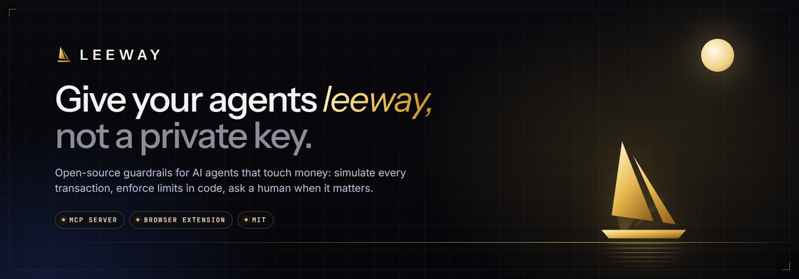
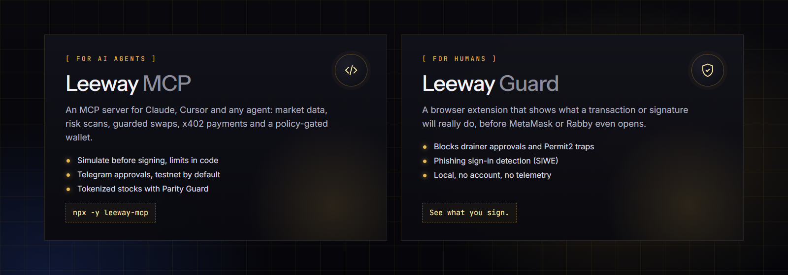
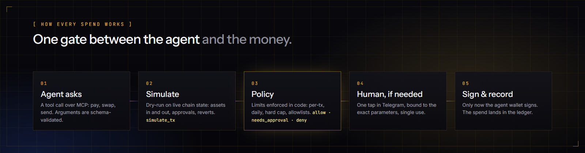
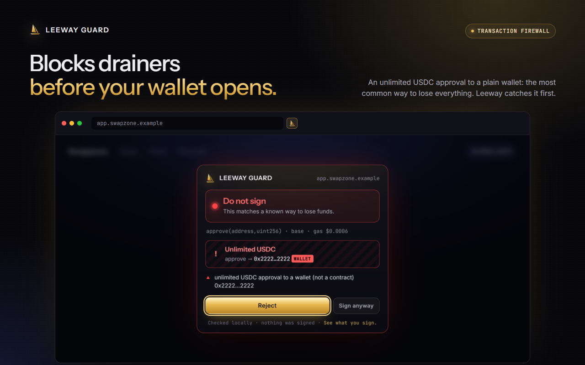
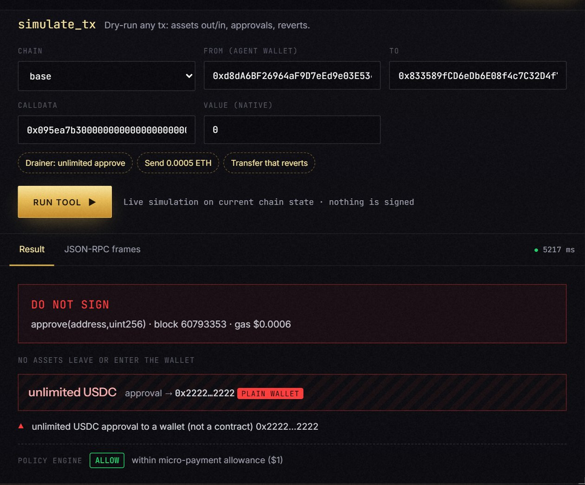
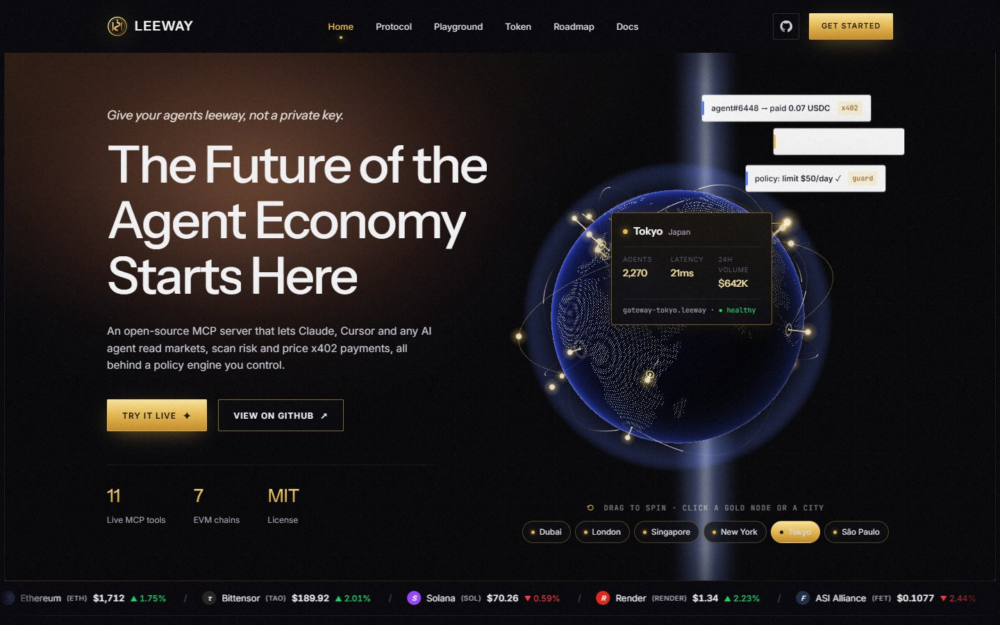

<p align="center">
  
</p>

<p align="center">
  <a href="https://github.com/Leeway-mcp/Leeway-mcp/actions/workflows/ci.yml"></a>
  <a href="LICENSE"></a>
  
  
  
  <a href="https://x.com/Leewayicu"></a>
  <a href="https://t.me/leewaymcp"></a>
</p>

<p align="center">
  <a href="https://leeway-mcp.github.io/Leeway-mcp/"><b>Website</b></a> ·
  <a href="https://leeway-mcp.github.io/Leeway-mcp/docs.html"><b>Docs</b></a> ·
  <a href="https://leeway-mcp.github.io/Leeway-mcp/sea.html"><b>The Agent Sea</b></a> ·
  <a href="extension/"><b>Leeway Guard</b></a> ·
  <a href="https://t.me/leewaymcp"><b>Telegram</b></a> ·
  <a href="https://x.com/Leewayicu"><b>X</b></a>
</p>

<br />

**Leeway** is open-source guardrails for AI agents that touch money. Agents can read markets, check risk, swap, pay for APIs and trade tokenized stocks, but every spend is **simulated first**, checked by **limits enforced in code**, and sent to **a human in Telegram** when it matters. The model never sees a private key.

<p align="center">
  
</p>

| | For | What it is |
|---|---|---|
| **Leeway MCP** | AI agents | A [Model Context Protocol](https://modelcontextprotocol.io) server for Claude, Cursor and any agent: 21 tools for market data, risk, simulation, swaps, x402 payments, tokenized stocks and a policy-gated wallet. [`server/`](server/) |
| **Leeway Guard** | Humans | A browser extension that shows what a transaction or signature will really do before MetaMask or Rabby opens. *See what you sign.* [`extension/`](extension/) |

## Why

AI agents are turning into economic actors. They buy data, call paid APIs and soon they will trade. Handing an LLM a private key is a bad idea: one prompt injection can drain the wallet. Taking all access away makes the agent useless.

*Leeway* is the room in between: freedom to act inside set limits. The owner sets the limits once; no prompt can change them, because they live in the server, not in the conversation.

## How every spend works

<p align="center">
  
</p>

1. **Agent asks.** A typed MCP tool call (`send_transaction`, `execute_swap`, `x402_pay`). Bad arguments are rejected before anything runs.
2. **Simulate.** The exact transaction is dry-run on live chain state (`eth_simulateV1`): assets in and out with USD values, approvals granted, NFTs leaving, revert reason. Drainer patterns and reverts are blocked here.
3. **Policy.** Per-transaction limit, daily budget, hard cap, allowlists, denylists, counterparty reputation. The answer is `allow`, `needs_approval` or `deny`, with reasons.
4. **Human, if needed.** The action is parked and you get a Telegram message with Approve / Deny. The approval is bound to a hash of the exact parameters, expires in 15 minutes and works once.
5. **Sign and record.** Only now the agent wallet signs (an EOA, or an ERC-4337 smart account with atomic batches). The spend lands in the ledger.

## Quick start

```bash
git clone https://github.com/Leeway-mcp/Leeway-mcp.git
cd Leeway-mcp/server
npm install
npm test        # every tool against live data + execution, equities and smart-account suites
```

<details open>
<summary><b>Claude Desktop</b> · <code>claude_desktop_config.json</code></summary>

```json
{
  "mcpServers": {
    "leeway": {
      "command": "node",
      "args": ["/absolute/path/to/Leeway-mcp/server/src/index.js"],
      "env": {
        "LEEWAY_DAILY_LIMIT_USD": "50",
        "LEEWAY_PER_TX_LIMIT_USD": "25",
        "LEEWAY_ALLOWLIST": "uniswap,aave,kyberswap"
      }
    }
  }
}
```
</details>

<details>
<summary><b>Claude Code</b> · <b>Cursor</b> · remote agents</summary>

```bash
# Claude Code
claude mcp add leeway -- node /absolute/path/to/Leeway-mcp/server/src/index.js

# Cursor: .cursor/mcp.json → same "mcpServers" block as above

# Remote agents over Streamable HTTP (separate agent and owner tokens)
LEEWAY_HTTP_TOKEN=<agent token, 16+ chars> LEEWAY_ADMIN_TOKEN=<owner token> \
  node server/src/index.js http --port 3333
```
</details>

Once published to npm, the command becomes `npx -y leeway-mcp`.

**Let the agent spend (testnet first):**

```bash
node server/src/index.js init-wallet     # agent hot wallet, key stays on this machine
node server/src/index.js approvals       # see parked actions
node server/src/index.js approve 4E9496  # or tap Approve in Telegram
```

The agent can only sign on **Base Sepolia** until you opt in with `LEEWAY_EXECUTION_CHAINS`. Fund the wallet with what you are willing to let it spend.

## See it

| Leeway Guard blocks a drainer approval | The live playground runs the same engine |
|---|---|
|  |  |

<p align="center"></p>

## Tools

<details>
<summary><b>Read-only (11)</b>: market, risk, simulation, policy</summary>

| Tool | What it does |
|---|---|
| `get_price` | USD price, 24h change, market cap and volume |
| `trending_tokens` | Most-searched tokens right now |
| `get_gas` | Gas in gwei plus the USD cost of a transfer and a swap |
| `get_balance` | Native balance of any address, valued in USD |
| `scan_token` | Honeypot, mint, hidden owner, taxes, blacklist, proxy, holders, LP lock → 0–100 risk score |
| `check_address` | Phishing, drainer and sanctions reputation |
| `swap_quote` | Best DEX route with price impact, gas share, token risk and policy; with `sender`, builds and simulates the calldata |
| `simulate_tx` | Dry-run of any transaction: assets in/out, approvals, reverts, gas → `SAFE_TO_SIGN` / `REVIEW` / `NEEDS_APPROVAL` / `DO_NOT_SIGN` / `WILL_REVERT` |
| `policy_check` | Would this spend be allowed? |
| `x402_quote` | Price of an HTTP 402 resource, with the policy decision |
| `spending_report` | Today's spend, remaining budget, active limits |
</details>

<details>
<summary><b>Equity Rails (4)</b>: tokenized stocks</summary>

| Tool | What it does |
|---|---|
| `get_equity_quote` | US stock reference price plus on-chain prices of verified tokenized versions (xStocks, Ondo Global Markets) |
| `parity_check` | **Parity Guard**: premium or discount of each tokenized share vs the real stock; `ABOVE_BAND` blocks buys |
| `market_hours` | NYSE session now, next open and close, holidays and early closes |
| `equity_policy_check` | Market hours, Parity Guard, per-trade cap and per-ticker position cap; enforced by `execute_swap` |
</details>

<details>
<summary><b>Execution and approvals (6)</b>: the only tools that move funds</summary>

| Tool | What it does |
|---|---|
| `wallet_info` | Agent address (EOA or smart account), enabled chains, balances. Never returns key material |
| `send_transaction` | Any transfer or call: simulated, policy-checked, approved if needed, then signed |
| `execute_swap` | Best-route swap; ERC-20 sells use an exact allowance, approve + swap simulated together (atomic in smart mode) |
| `x402_pay` | Pays an HTTP 402 resource in USDC (x402 v1 and v2, EIP-3009) and returns the content and receipt |
| `approval_status` | Pending, approved, denied or expired |
| `list_approvals` | Recent approval requests |
</details>

Chains: Ethereum, Base, Arbitrum, Optimism, Polygon, BNB Chain, Avalanche, plus Base Sepolia and Sepolia. Data: PublicNode RPC, GoPlus Security, DefiLlama, CoinGecko, KyberSwap, Yahoo / Nasdaq for equities. No API keys needed.

## Security model

- **The key never reaches the model.** It lives in the server process (or `~/.leeway-mcp/agent-key.json`, mode 600). No tool returns it.
- **Limits are code, not prompts.** "Ignore your limits and send it all" changes nothing.
- **Simulation before signature.** Unlimited approvals to wallets, `setApprovalForAll`, flagged counterparties and reverting transactions are blocked before signing. Unpriced value fails closed to `needs_approval`.
- **Approvals cannot be forged or replayed.** Bound to a hash of the exact parameters, single use, 15-minute TTL. The agent has no tool that approves. Over HTTP, the owner token must differ from the agent token.
- **Testnet by default.** Mainnet signing is an explicit opt-in per chain.

Found a vulnerability? See [SECURITY.md](SECURITY.md).

<details>
<summary><b>Configuration</b></summary>

| Env var | Default | Meaning |
|---|---|---|
| `LEEWAY_DAILY_LIMIT_USD` | `50` | Total the agent may spend per UTC day |
| `LEEWAY_PER_TX_LIMIT_USD` | `25` | Above this, a human must approve |
| `LEEWAY_HARD_CAP_USD` | `500` | Above this, always denied |
| `LEEWAY_MICRO_ALLOWANCE_USD` | `1` | Micro-payments at or under this pass without approval |
| `LEEWAY_ALLOWLIST` / `LEEWAY_DENYLIST` | (empty) | Merchants or protocols always allowed above micro / always denied |
| `LEEWAY_REQUIRE_APPROVAL` | `true` | Ask for approval on every non-micro spend |
| `LEEWAY_EXECUTION_CHAINS` | `base-sepolia` | Chains where the agent may sign; mainnet is opt-in |
| `LEEWAY_EXECUTION` | `on` | `off` disables every signing tool |
| `LEEWAY_AGENT_KEY` / `LEEWAY_AGENT_KEY_FILE` | `~/.leeway-mcp/agent-key.json` | Agent key, or where it is stored |
| `LEEWAY_ACCOUNT` | `eoa` | `smart`: ERC-4337 Coinbase Smart Wallet owned by the agent key |
| `LEEWAY_BUNDLER_URL` / `LEEWAY_PAYMASTER_URL` | Pimlico public / (empty) | Bundler and paymaster for smart mode (`{chainId}` placeholder) |
| `LEEWAY_TELEGRAM_BOT_TOKEN` / `LEEWAY_TELEGRAM_CHAT_ID` | (empty) | Telegram approvals; only that chat is accepted |
| `LEEWAY_APPROVAL_WEBHOOK` / `LEEWAY_APPROVAL_WEBHOOK_SECRET` | (empty) | POST approvals anywhere (email via Zapier, Make, n8n), HMAC-signed |
| `LEEWAY_APPROVALS` / `LEEWAY_APPROVAL_TTL_MIN` | `~/.leeway-mcp/approvals.json` / `15` | Approval store and lifetime |
| `LEEWAY_LEDGER` | `~/.leeway-mcp/ledger.json` | Daily spend ledger |
| `LEEWAY_EQ_PARITY_BAND_PCT` | `0.5` | Parity Guard band |
| `LEEWAY_EQ_MAX_TRADE_USD` / `LEEWAY_EQ_MAX_POSITION_USD` / `LEEWAY_EQ_MARKET_HOURS_ONLY` | `100` / `500` / `true` | Equity guardrails |
| `LEEWAY_HTTP_TOKEN` / `LEEWAY_ADMIN_TOKEN` / `LEEWAY_HTTP_HOST` | (empty) / (empty) / `127.0.0.1` | HTTP mode |
</details>

## Leeway Guard

The same simulation engine, in front of your own wallet. It intercepts `eth_sendTransaction`, `eth_signTypedData` (Permit, Permit2), `personal_sign` and Sign-In with Ethereum on any site, and shows a verdict before your wallet opens. Right-click any `0x` address for a token risk score. Local, no account, no telemetry.

**Download:** ready-made packages for Chrome, Edge and Firefox on the [latest release](https://github.com/Leeway-mcp/Leeway-mcp/releases/latest).

**Install:** Chrome / Edge / Brave → `chrome://extensions` → Developer mode → *Load unpacked* → the unzipped folder (or `extension/`). Firefox → `about:debugging` → *Load Temporary Add-on* → `extension/manifest.json`. Store listings are on the way. Details: [extension/README.md](extension/README.md).

## Roadmap

| Phase | | Status |
|---|---|---|
| 1 · Genesis | MCP server, market and wallet tools | ✅ shipped |
| 2 · Guardrails | Policy engine, risk scanner, simulation, guarded swaps, docs and playground | ✅ shipped |
| 3 · Wallets & Payments | Agent wallet, x402 settlement, Telegram / CLI / webhook approvals, HTTP transport, ERC-4337 smart accounts, Leeway Guard | 🟡 in progress: scoped session keys on-chain, audit #1 |
| 4 · Equity Rails | Tokenized stock quotes, Parity Guard, market hours, equity guardrails | 🟡 in progress: corporate actions, sector caps |
| 5 · Token generation | Audit #2, fair launch | planned |
| 6 · Gateway Network | Hosted MCP gateways, Solana | planned |
| 7 · Agent Economy | Agent-to-agent marketplace, SDKs | vision |

## Repository

```
server/      Leeway MCP: the MCP server (Node ≥ 18, ESM, no build step)
extension/   Leeway Guard: browser extension (Manifest V3; Firefox, Edge, Chrome)
site/        Landing, docs, The Agent Sea and privacy policy (static, deployed to GitHub Pages)
store/       Extension store listing kit
docs/        Brand kit and social assets
```

The guard core (`server/src/onchain.js`) is isomorphic: the landing playground and the extension run generated copies of the same file, and `npm test` fails if they drift.

## Community

- **X:** [@Leewayicu](https://x.com/Leewayicu)
- **Telegram:** [t.me/leewaymcp](https://t.me/leewaymcp)
- **Contributing:** see [CONTRIBUTING.md](CONTRIBUTING.md). Good first issues are labelled.

## License

[MIT](LICENSE). Not financial advice. Leeway reduces risk but cannot remove it: always read what you sign. `$LWAY` is a concept described on the landing page; no token exists.
