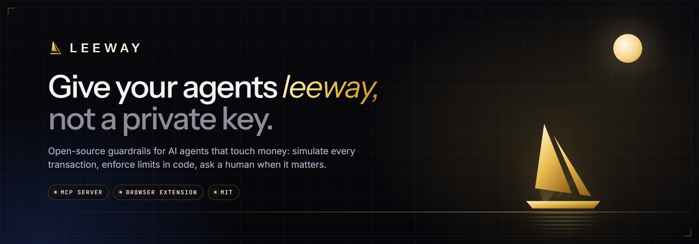

<p align="center"></p>

# leeway-mcp

**Give your agents leeway, not a private key.**

MCP server that gives Claude, Cursor and any AI agent safe, policy-guarded access to on-chain value. No API keys needed.

```json
{
  "mcpServers": {
    "leeway": {
      "command": "npx",
      "args": ["-y", "leeway-mcp"],
      "env": { "LEEWAY_DAILY_LIMIT_USD": "50", "LEEWAY_PER_TX_LIMIT_USD": "25" }
    }
  }
}
```

**21 tools.** Read-only: `get_price`, `trending_tokens`, `get_gas`, `get_balance`, `scan_token`, `check_address`, `swap_quote`, `simulate_tx`, `policy_check`, `x402_quote`, `spending_report`. Equity Rails: `get_equity_quote`, `parity_check`, `market_hours`, `equity_policy_check`. Execution: `wallet_info`, `send_transaction`, `execute_swap`, `x402_pay`, `approval_status`, `list_approvals`.

Every spend is simulated, checked by a policy engine enforced in code (`allow` / `needs_approval` / `deny`), and parked for your approval in Telegram when needed. The agent signs only on chains you enable (default: Base Sepolia testnet).

```bash
npx leeway-mcp init-wallet     # agent hot wallet
npx leeway-mcp approve <id>    # approve a parked spend
npx leeway-mcp http            # remote agents over Streamable HTTP
```

Full docs, configuration and roadmap: [github.com/Leeway-mcp/Leeway-mcp](https://github.com/Leeway-mcp/Leeway-mcp) · [Website](https://leeway.icu/) · [X](https://x.com/Leewayicu) · [Telegram](https://t.me/leewaymcp)

MIT · Not financial advice.
